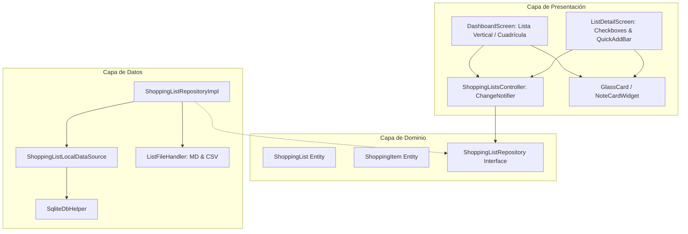

# Documento Técnico: Arquitectura y Plan de Sprint 1 - ShopLiist Pro OCR

## 1. Visión y Alcance
ShopLiist Pro OCR es una aplicación móvil desarrollada en Flutter con arquitectura limpia (Clean Architecture), persistencia local (SQLite), interoperabilidad universal (.md y .csv) y diseño glassmorphic con tonos pastel apetitosos.

El **Sprint 1** entrega el núcleo funcional de la aplicación con funcionamiento 100% offline:
- **Gestión reactiva de estado**: Basada en `ChangeNotifier` y `ListenableBuilder` de Flutter.
- **Persistencia local**: Base de datos SQLite (`sqflite`) con tablas relacionales `shopping_lists` y `shopping_items`, cascada de eliminación e índices de búsqueda rápida.
- **Interoperabilidad universal**: Exportación e importación de listas en Markdown (estándar `- [ ]` / `- [x]`) y CSV (RFC 4180).
- **Diseño Glassmorphic Pastel**:
  - Colores: Verdeagua (`Mint`), Azul (`Sky`), Rosa (`Blush`), Amarillo (`Butter`) y Lavanda (`Lavender`).
  - Modos Claro y Oscuro con desenfoque de fondo (`ImageFilter.blur`) y transparencias calculadas estrictamente con `Color.withValues(alpha: ...)`.
- **Experiencia de usuario**: Vista vertical estructurada con selector de alternancia a cuadrícula de 2 columnas, adición rápida de productos y checkboxes instantáneos.

---

## 2. Diagrama de Arquitectura



---

## 3. Esquema de Base de Datos SQLite (DDL)

```sql
CREATE TABLE shopping_lists (
    id TEXT PRIMARY KEY,
    title TEXT NOT NULL,
    color_index INTEGER NOT NULL DEFAULT 0,
    is_pinned INTEGER NOT NULL DEFAULT 0,
    is_archived INTEGER NOT NULL DEFAULT 0,
    created_at TEXT NOT NULL,
    updated_at TEXT NOT NULL
);

CREATE TABLE shopping_items (
    id TEXT PRIMARY KEY,
    list_id TEXT NOT NULL,
    name TEXT NOT NULL,
    quantity TEXT,
    category TEXT,
    is_completed INTEGER NOT NULL DEFAULT 0,
    sort_order INTEGER NOT NULL DEFAULT 0,
    created_at TEXT NOT NULL,
    FOREIGN KEY (list_id) REFERENCES shopping_lists(id) ON DELETE CASCADE
);

CREATE INDEX idx_items_list_id ON shopping_items(list_id);
CREATE INDEX idx_items_completed ON shopping_items(is_completed);
```

---

## 4. Paleta de Colores Pastel y Glassmorphism

| Color | Nombre | Modo Claro (Fondo / Acento) | Modo Oscuro (Fondo / Acento) |
|---|---|---|---|
| 0 | Verdeagua (Mint) | `#D8F3DC` / `#2D6A4F` | `#1B3B36` / `#74C69D` |
| 1 | Azul Pastel (Sky) | `#E0EEFD` / `#2B6CB0` | `#1E2D44` / `#90CDF4` |
| 2 | Rosa Pastel (Blush) | `#FDE2E4` / `#C53030` | `#3D2028` / `#FEB2B2` |
| 3 | Amarillo Mantequilla (Butter) | `#FFF1C5` / `#D69E2E` | `#3E341B` / `#F6E05E` |
| 4 | Lavanda (Lavender) | `#EDE4FF` / `#6B46C1` | `#2E2242` / `#D6BCFA` |

### Especificación Glassmorphic:
- **Efecto de Desenfoque**: `BackdropFilter` con `sigmaX: 12, sigmaY: 12`.
- **Fondo Translúcido**: `Color.withValues(alpha: isDark ? 0.35 : 0.65)`.
- **Borde de Cristal**: `Border.all(color: Colors.white.withValues(alpha: isDark ? 0.12 : 0.40), width: 1.2)`.
- **Sombras Suaves**: `BoxShadow(color: Colors.black.withValues(alpha: isDark ? 0.30 : 0.06), blurRadius: 16, offset: Offset(0, 6))`.
