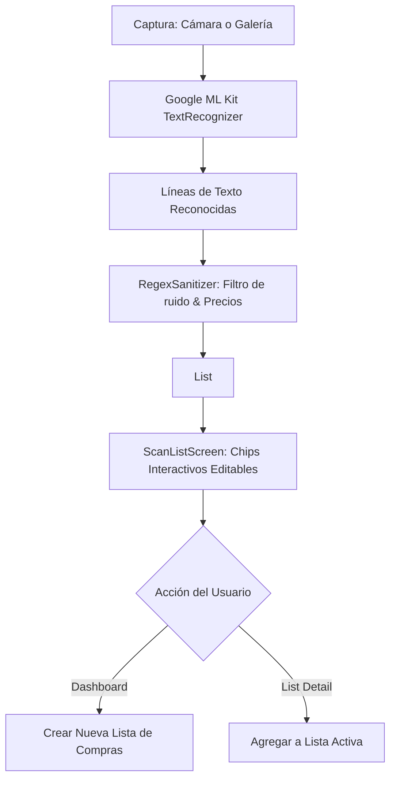

# Documento Técnico: Arquitectura y Plan de Sprint 2 - Módulo OCR On-Device

## 1. Visión y Alcance
El **Sprint 2** de **ShopLiist Pro OCR** integra la digitalización visual de productos mediante reconocimiento óptico de caracteres (OCR) ejecutado en el dispositivo móvil:
- **Captura Flexible**: Cámara nativa y selección desde la galería (`image_picker`).
- **Inferencia On-Device**: Motor Google ML Kit Text Recognition (`google_mlkit_text_recognition`) con script latino, garantizando funcionamiento 100% offline y privacidad de datos.
- **Sanitización con Regex (`RegexSanitizer`)**: Limpieza de ruido de tickets (totales, IVA, fechas, números de caja) y extracción inteligente de cantidades.
- **Interfaz Interactiva (`ScanListScreen`)**: Previsualización de imagen, chips seleccionables y editables, y adición masiva a listas existentes o creación de nuevas listas.
- **Gestión de Memoria Nativa C++**: Liberación estricta de memoria mediante el método `close()` / `dispose()`.

---

## 2. Diagrama de Flujo OCR

---

## 3. Especificación de Sanitización Regex

| Patrón | Expresión Regular | Acción |
|---|---|---|
| Precios | `(?:\$|€|USD|EUR)\s*\d+(?:[.,]\d+)?|\d+(?:[.,]\d+)?\s*(?:€|eur|usd|\$)` | Eliminado del texto |
| Cantidades | `^(\d+(?:[.,]\d+)?\s*(?:kg|g|l|ml|oz|lb|unid|pza|uds|botellas|latas|cajas)?)\s+(.+)$` | Extrae cantidad y nombre |
| Encabezados Ticket | `\b(?:TOTAL|SUBTOTAL|TICKET|FACTURA|IVA|CAJA|CAMBIO|VISA|MASTERCARD)\b` | Línea descartada por ruido |
| Fechas y Horas | `\b\d{1,2}[/-]\d{1,2}[/-]\d{2,4}\b|\b\d{1,2}:\d{2}(?::\d{2})?\b` | Línea descartada por ruido |
