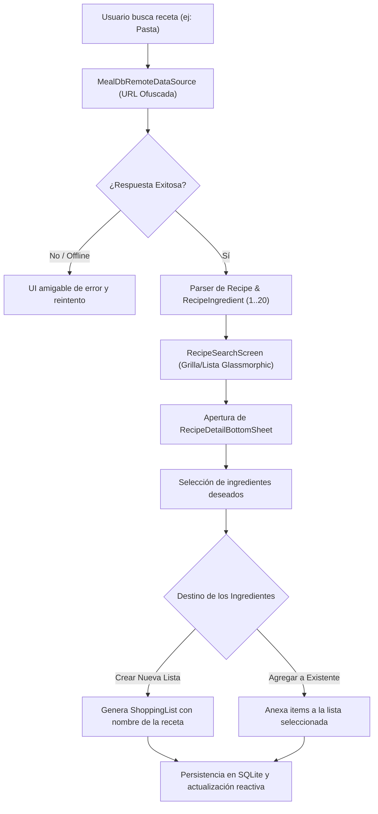

# Plan de Desarrollo y Arquitectura - Sprint 3: Buscador de Recetas y Agregado Inteligente

Este documento contiene la especificación arquitectónica y el desglose de tareas para la ejecución del **Sprint 3** del proyecto **ShopLiist Pro**, dando cumplimiento a los requerimientos de TheMealDB, importación fluida de ingredientes, autocompletado y pulido de UI.

---

## 1. Resumen Ejecutivo y Metas del Sprint
El objetivo principal del Sprint 3 es enriquecer la experiencia del usuario conectando la app con un catálogo gastronómico real (TheMealDB) y acelerando la creación de listas de compras mediante la importación en lote de ingredientes y el autocompletado inteligente en el ingreso rápido de productos.

### Puntos Clave:
1. **TheMealDB API Client**:
   - Conexión HTTPS robusta y segura.
   - Resolución dinámica de la URL con ofuscación XOR (`0x5A`) y variable `--dart-define=MEALDB_API_URL=...` (`EndpointSecurity`).
   - Normalización de las llaves dinámicas `strIngredient1..20` y `strMeasure1..20`.
2. **Importación Masiva de Ingredientes**:
   - Previsualización en modal/hoja inferior (BottomSheet) con checkboxes glassmórficos.
   - Creación directa de una nueva lista o adición a una lista preexistente.
3. **Catálogo de Autocompletado Local**:
   - Sugerencias en tiempo real en la barra de agregado rápido (`QuickAddBar`) alimentadas por el historial de SQLite (`SELECT DISTINCT name FROM shopping_items`).
4. **Resiliencia de Red**:
   - Experiencia de usuario libre de bloqueos ante falta de conectividad (offline), timeouts o respuestas imprevistas.
5. **Estética Glassmórfica Pastel**:
   - Consistencia visual con paletas Menta, Cielo, Rosa, Vainilla y Lavanda, transiciones suaves y cero uso de `Color.withOpacity`.

---

## 2. Diagrama de Flujo del Proceso

---

## 3. Plan de Commits Atómicos
1. `feat(setup): add http dependency and network exception abstractions`
2. `feat(recipes-domain): define Recipe, RecipeIngredient and RecipeRepository contract`
3. `feat(recipes-data): implement MealDbRemoteDataSource and RecipeRepositoryImpl with unrolled parser`
4. `feat(recipes-presentation): implement RecipeSearchController and recipe UI with glassmorphic cards`
5. `feat(integration): integrate recipe ingredients import and local autocomplete in quick add`
6. `test(recipes): complete unit and widget tests for recipes and autocomplete`
